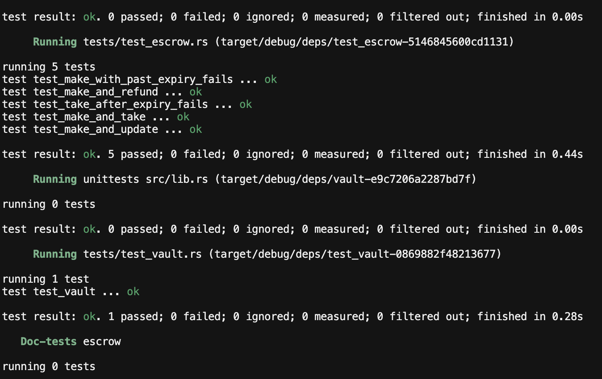

# Week 2 Assignment (Vault and Escrow)

The goal of this assignment is to:

1. Write the vault program, including the withdraw and close instructions.
2. Write the escrow program with all instructions (make, take, refund, update).
3. Write tests covering all the instructions using Rust and LiteSVM.

And optionally:

4. Upgrade the escrow to run on a timed mechanism using the clock sysvar (a timed escrow).
5. Design the vault to be non-custodial, so users can redeem their position in kind and exit at any time.

Both programs live in one Anchor workspace: `programs/vault` and `programs/escrow`.

## Code Documentation

- Anchor: https://www.anchor-lang.com/docs
- Program Derived Addresses: https://solana.com/docs/core/pda
- Cross Program Invocation: https://solana.com/docs/core/cpi
- Tokens on Solana: https://solana.com/docs/tokens
- LiteSVM: https://github.com/LiteSVM/litesvm

## Results (Vault)

### **Step 1:** Setting up the workspace

- Created one Anchor workspace for both programs with `anchor init`, then added the escrow with `anchor new escrow`
- Removed the default counter template (`increment`, `Counter`) from the vault
- The Rust toolchain is pinned to 1.89 in `rust-toolchain.toml` to match the Solana build tools

### **Step 2:** State and seeds

- `src/state.rs` defines `VaultState`, which stores two bumps: `vault_bump` and `state_bump`
- `src/constants.rs` defines the two PDA seeds: `VAULT_SEED` (`b"vault"`) and `STATE_SEED` (`b"state"`)
- Each user gets two PDAs, both derived from their public key:
  - `vault_state` (seeds `["state", user]`): owned by the program, stores the bumps
  - `vault` (seeds `["vault", user]`): a plain system account that holds the SOL
- The bumps are saved once so later instructions can reuse them instead of searching for them again

### **Step 3:** Initialize

- `src/instructions/initialize.rs` creates the `vault_state` account with `init`, paid for by the user
- Space is `VaultState::DISCRIMINATOR.len() + VaultState::INIT_SPACE` (8 byte discriminator + 2 bytes of bumps)
- The `vault` has no `init`: it only comes into existence when SOL is sent to it
- So `initialize` sends the rent-exempt minimum into the vault with a CPI to the System Program
  - Without this, a first deposit smaller than the minimum (about 0.00089 SOL) would be rejected
- Both bumps from `ctx.bumps` are saved into `vault_state`

### **Step 4:** Deposit

- `src/instructions/deposit.rs` moves SOL from the user to the vault
- `vault_state` and `vault` are checked using the saved bumps (`bump = vault_state.state_bump`)
- `require!(amount > 0)` rejects zero deposits with `VaultError::InvalidAmount`
- A CPI to the System Program's `transfer` moves the SOL; the user signs, so a plain `CpiContext::new` works

### **Step 5:** Withdraw

- `src/instructions/withdraw.rs` moves SOL from the vault back to the user
- The vault is a PDA with no private key, so the program signs for it with signer seeds: `["vault", user, vault_bump]`
- The CPI uses `CpiContext::new_with_signer` instead of `CpiContext::new`
- Two checks run before the transfer:
  - `amount > 0`, else `VaultError::InvalidAmount`
  - `amount <= vault balance - rent`, else `VaultError::InsufficientBalance`
- The second check keeps the vault rent-exempt, since an account can't sit between 0 and the rent minimum. Emptying the vault completely is left to `close`

### **Step 6:** Close

- `src/instructions/close.rs` empties the vault and closes `vault_state`
- The full vault balance is sent to the user with the same PDA-signed CPI as `withdraw`. Going to exactly 0 is allowed, so the vault account stops existing
- `vault_state` has the `close = user` constraint, so Anchor closes it after the instruction and returns its rent to the user

### **Step 7:** Testing with LiteSVM

- `tests/test_vault.rs` runs the full lifecycle in one test: initialize → deposit → withdraw → close
- `setup()` builds a fresh LiteSVM chain, loads the compiled program from `target/deploy/vault.so`, airdrops 2 SOL to a new user and works out both PDAs
  - Everything is returned in a `TestContext` struct so the test itself only builds and sends instructions
- `send_instruction()` wraps an instruction in a transaction, signs it as the user and sends it
- The results are checked after every step:
  - After initialize: the vault holds the rent-exempt minimum and `vault_state` exists
  - After deposit (0.1 SOL): the vault holds rent + deposit
  - After withdraw (0.05 SOL): the vault holds rent + deposit - withdraw
  - After close: both the vault and `vault_state` no longer exist

## Results (Escrow)

### **Step 1:** State and seeds

- `src/state.rs` defines the `Escrow` account, which stores the terms of the swap:
  - `seed`: a number chosen by the maker, so one maker can have several escrows open at once
  - `maker`: who created the escrow and gets refunds and rent back
  - `mint_a` / `mint_b`: the token offered and the token wanted
  - `receive`: how much token B the maker wants
  - `bump`: saved for PDA checking and signing
  - `expiration`: an optional deadline (see step 6)
- `src/constants.rs` defines `ESCROW_SEED` (`b"escrow"`); each escrow's address comes from `["escrow", maker, seed]`
- The amount of token A locked is not stored, since it can be read from the vault's balance

### **Step 2:** Make

- `src/instructions/make.rs` creates the escrow and locks the maker's token A in a vault
- New accounts are created with `init`, paid for by the maker:
  - `escrow`: the state account, using `#[instruction(seed: u64)]` so the seed argument can be used in its PDA seeds
  - `vault`: an Associated Token Account for token A whose authority is the `escrow` PDA, so only the program can release the tokens
- Mints and token accounts use the token interface types (`InterfaceAccount`, `Interface<TokenInterface>`), so both Token and Token-2022 are supported
- `make` is split into two helpers called one after the other:
  - `init_escrow` saves the terms with `set_inner`
  - `deposit_tokens` moves token A from the maker's ATA into the vault with `transfer_checked`, which also checks the mint's decimals

### **Step 3:** Refund

- `src/instructions/refund.rs` lets the maker cancel and get everything back
- `has_one = maker` and `has_one = mint_a` check the accounts passed in match what's stored in the escrow
- The escrow's seeds are rebuilt from the saved `escrow.seed` and `escrow.bump`
- The `escrow` PDA signs to send all of the vault's token A back to the maker
- The vault is then closed with a `close_account` CPI to the Token Program. Anchor's `close` constraint only works on the program's own accounts, so a token account needs a CPI
- `escrow` has `close = maker`, so Anchor closes it last. It holds the seed and bump needed to sign for the vault

### **Step 4:** Take

- `src/instructions/take.rs` lets anyone accept the deal; the taker signs and the maker doesn't need to be online
- The maker is a `SystemAccount` (not a `Signer`) because they only receive rent back
- `init_if_needed` creates the maker's token B account and the taker's token A account if they don't exist yet, paid for by the taker
- `has_one = mint_b` stops a taker from paying with a different token than the one the maker asked for
- `take` is split into two helpers:
  - `deposit_tokens` sends `escrow.receive` token B from the taker to the maker
  - `withdraw_and_close` sends all of the vault's token A to the taker (signed by the escrow), then closes the vault
- The transaction is atomic: if any step fails, the whole swap is undone

### **Step 5:** Update

- `src/instructions/update.rs` lets the maker change the price (`receive`) and the expiration
- Only two accounts are needed: the maker (signer) and the escrow. No tokens move
- `has_one = maker` makes sure only the escrow's own maker can update it

### **Step 6:** Timed escrow (optional)

- `expiration` is stored as an `Option<i64>` unix timestamp, so a deadline is optional (`None` means it never expires)
- The current time is read from the Clock sysvar with `Clock::get()?.unix_timestamp`
- In `make` and `update`, a given expiration must be in the future, else `EscrowError::InvalidExpiration`
- In `take`, the escrow can't be taken after the expiration, else `EscrowError::EscrowExpired`
- Programs can't run on their own, so nothing happens automatically at the deadline. The maker can call `refund` at any time

### **Step 7:** Testing with LiteSVM

- `tests/test_escrow.rs` tests every instruction, plus the two expiry rules
- Test tokens are created with `litesvm-token`, which wraps the Token Program's instructions into one-line builders
- `setup()` builds the whole test world and returns it in a `TestContext` struct:
  - A fresh LiteSVM chain with the program loaded from `target/deploy/escrow.so`
  - A maker and a taker, each airdropped 2 SOL
  - Two mints (token A and token B) with 6 decimals, created with `CreateMint`
  - The maker's token A account and the taker's token B account, created with `CreateAssociatedTokenAccount` and funded with 1,000 tokens each using `MintTo`
  - The escrow PDA (using a fixed seed of 42) and the vault's address
- Helper functions build each instruction (`make_instruction`, `take_instruction`, `refund_instruction`, `update_instruction`), read token balances and the escrow account, and move the chain's clock forward
- Happy path tests:
  - `test_make_and_refund`: the maker locks 10 token A, then refunds. The vault and escrow are closed and the maker has all their token A back
  - `test_make_and_take`: the maker offers 10 token A for 50 token B and the taker accepts. The maker receives 50 token B, the taker receives 10 token A, and the vault and escrow are closed
  - `test_make_and_update`: the maker changes the price from 50 to 40 token B and adds a one-day expiration
- Failure tests:
  - `test_take_after_expiry_fails`: the clock is moved past the expiration and `take` fails with `EscrowExpired`. The maker's token A stays in the vault
  - `test_make_with_past_expiry_fails`: `make` with an expiration in the past fails with `InvalidExpiration`
- Failures are checked by confirming the transaction returned an error, and that the program logs contain the expected error name

## Running the tests

```bash
anchor build
cargo test
```

`anchor build` must run first, as the tests load the compiled programs from `target/deploy/`.

All 6 tests passing (5 escrow, 1 vault):


